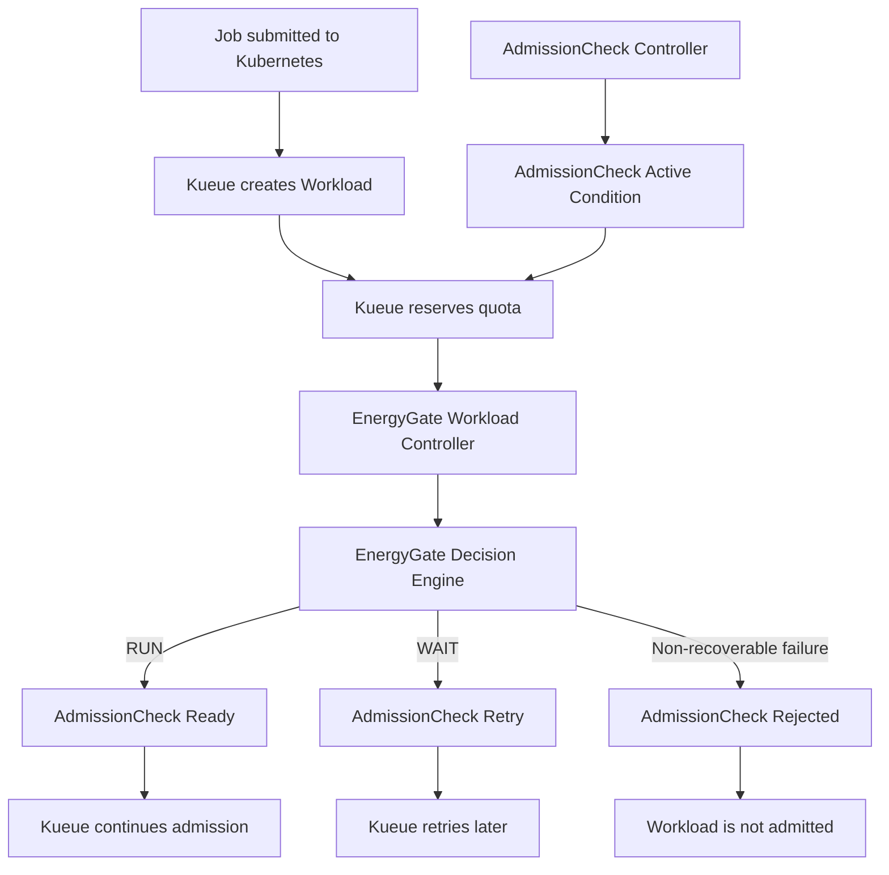

# EnergyGate Controller Architecture

## Overview

EnergyGate integrates with Kueue through an AdmissionCheck controller and a Workload controller. The AdmissionCheck controller reports whether EnergyGate is ready to evaluate workloads. The Workload controller will evaluate individual workloads using the EnergyGate Decision Engine.

## Architecture

## Controller Responsibilities

### AdmissionCheck Controller

- Watches Kueue AdmissionCheck resources.
- Identifies the AdmissionCheck owned by EnergyGate.
- Updates the Active condition to report controller readiness.
- Preserves unrelated conditions.

### Workload Controller

- Watches Kueue Workload resources.
- Identifies EnergyGate's admission-check entry.
- Obtains a decision from the EnergyGate Decision Engine.
- Maps RUN to Ready and WAIT to Retry.
- Uses Rejected only for genuine non-recoverable failures.
- Preserves admission-check entries owned by other controllers.

## Current Implementation Status

- Kind cluster and Kueue are running locally.
- The EnergyGate AdmissionCheck is configured.
- The AdmissionCheck controller is registered and has activated the check in the local cluster.
- Kueue has reserved quota for the sample workload.
- The Workload controller is scaffolded; Decision Engine integration and workload-state transitions remain to be implemented.

## Pending Integration

The Decision Engine interface, workload input fields, response format, and retry delay must be confirmed with the Decision Engine developer before implementing the final Workload reconciliation logic.
