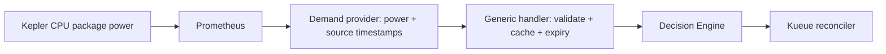

# Kepler demand signal

The production adapter is `controller/internal/signals/adapters/demand`.
It replaces the dummy provider and implements the shared `signals.SignalProvider`.
The root `internal/provider/kepler` and its CLI remain standalone legacy tools;
they are not a dependency of the controller image.



## Contract

```json
{
  "signal_type": "demand_cap",
  "provider": "kepler",
  "region": "IN-SO",
  "value": 7.5,
  "unit": "kW",
  "cap": 10,
  "utilization": 0.75,
  "status": "WITHIN_CAP",
  "timestamp": "2026-11-10T10:00:00Z",
  "collected_at": "2026-11-10T10:00:15Z",
  "valid_until": "2026-11-10T10:01:00Z",
  "is_forecast": false,
  "quality": "FRESH"
}
```

Power and cap use kW. Utilization is `value/cap`, without clipping. Equality is
WITHIN_CAP; only a greater value is EXCEEDED. Zero, negative, non-finite caps and
non-finite/negative demand are errors. Demand forecasts are not supported (the
optional forecast interface is deliberately absent).

## Configuration and wiring

```go
provider, err := demand.NewProvider(demand.Config{
    PrometheusURL: "http://prometheus-kube-prometheus-prometheus.monitoring.svc:9090",
    Region: "IN-SO",
    CapKW: 10,
    MaxSampleAge: time.Minute,
    Timeout: 5 * time.Second,
})
// Handle err, then register alongside the carbon and cost providers:
router, err := signals.NewProviderRouter(map[string]signals.SignalProvider{
    signals.SignalTypeDemandCap: provider,
    // signals.SignalTypeCarbon: carbonProvider,
    // signals.SignalTypeCost: costProvider,
})
// Handle err before constructing/using the handler.
handler := signals.NewHandler(router)
```

The region binds this Prometheus endpoint to the configured deployment; it does
not infer a grid zone from metrics. Requests for other regions fail. Canonical
region mapping for carbon/cost remains the shared integration owner's work.

| Setting | Default / meaning |
|---|---|
| PrometheusURL | Required HTTP(S) endpoint; path prefixes supported |
| Region | Required canonical deployment identifier |
| CapKW | Required positive finite cap |
| Query | `sum(kepler_node_cpu_watts{zone="package"})` |
| TimestampQuery | `min(timestamp(kepler_node_cpu_watts{zone="package"}))` |
| MaxSampleAge | 1 minute |
| Timeout | 5 seconds across both HTTP requests |
| Synthetic | false; set true when using a fake meter |

Custom power expressions require a matching TimestampQuery selecting the same
sources. Both queries use one evaluation instant. TimestampQuery's **value** is
the oldest contributing scrape time. An aggregate's evaluation timestamp alone
cannot establish source freshness. `valid_until = source time + MaxSampleAge`;
collection and cache hits never extend it.

Use one non-duplicated package series per node; exclude duplicate RAPL interfaces.
The default sum covers available series, so a missing node past Prometheus's
lookback period cannot be discovered from that sum alone. For a fixed three-node
cluster, configure Query as
`sum(kepler_node_cpu_watts{zone="package"}) and on() (count(kepler_node_cpu_watts{zone="package"}) == 3)`
and retain the matching TimestampQuery. A missing series then yields no signal.
Review target health and node coverage before interpreting a cluster total.

## Cache and failures (#10)

The shared handler owns the production cache. It returns cached demand as CACHED
while both max age and source expiry permit it, otherwise fetches again. The
adapter reports FRESH, or `simulated` when Synthetic is true (cache hits preserve
that synthetic label). The default maximum handler age is one hour; demand's
one-minute source expiry is always the earlier bound.

Expired, unavailable, malformed, negative or non-finite samples return errors;
expired data is never admitted as a current signal. STALE is an unavailable state,
not a successful production response. The Decision Engine/reconciler must map this
error to the agreed WAIT/retry behavior; this adapter does not update Kueue.
The legacy CachedProvider still offers explicit STALE/fail-closed policies, now
bounded by `valid_until`; do not wrap it around this adapter.

This resolves caching in one place, as proposed in TEAM-INTEGRATION-PLAN.md.
Issue #10's original requirement to return stale values is represented by an
unavailable/error outcome in the production path and needs this behavior recorded
when the issue is closed.

## Run and test

Use the same `carbongate` cluster as Kueue (see [setup](kepler-setup.md)).

```sh
kubectl --context kind-carbongate -n monitoring port-forward svc/prometheus-kube-prometheus-prometheus 9090:9090
# In another terminal, from controller/ (Go 1.27):
go run ./cmd/demand-probe -prometheus http://localhost:9090 -region IN-SO -cap-kw 10
go test -race ./internal/signals/... ./cmd/demand-probe
go vet ./internal/signals/... ./cmd/demand-probe
# From repository root (Go 1.24+):
go test -race ./...
go vet ./...
```

The production probe prints EXCEEDED as a valid JSON result; any retrieval/config
error exits nonzero. It queries via provider → router → handler. Add `-synthetic`
for fake CPU meter mode. The root legacy probe has different flags/exit codes.
Root-level `.github/workflows/demand.yml` runs both module suites separately.

CPU package power excludes GPUs and other whole-system components. Pod/container
CPU energy is attributed/estimated by Kepler, even with real node RAPL. Fake-meter
values are synthetic and cannot establish real carbon savings.

Historical prediction datasets: [energy export](energy-export.md).
