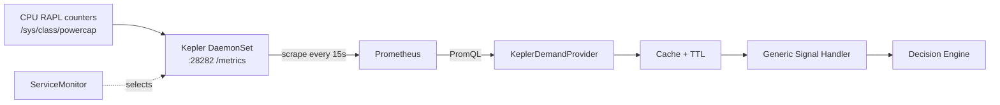

# Kepler + Prometheus on Kind

How to run Kepler (power metrics) and Prometheus on a local Kind cluster, so the
`KeplerDemandProvider` can query `kepler_node_cpu_watts`.

- Quick path: run `scripts/setup-kind-kepler.sh` (see [Automated setup](#automated-setup)).
- Manual path: follow [Manual setup](#manual-setup).

## Pipeline



## Environments tested

| Environment | RAPL available | Kepler mode | Result |
|---|---|---|---|
| Kind in WSL2 (Windows) | No | Fake CPU meter | Works, values synthetic (about 1e-4 W) |
| Fedora on bare metal (external SSD) | Yes | Real RAPL | Works, real values |

Kepler v0.12.0, kube-prometheus-stack, Kind.

## What is RAPL and why it matters

RAPL (Running Average Power Limit) is a set of energy counters built into Intel and
AMD Zen CPUs. Linux exposes them under `/sys/class/powercap/`. Kepler reads them and
turns them into watts. Without RAPL (WSL2, most VMs, most cloud instances) Kepler
exits with `no RAPL zones found`, and the only option is the fake meter.

RAPL covers the CPU and DRAM only, not GPUs, fans, NICs or PSU losses. Demand from
Kepler is therefore CPU power, not whole-node power.

## Prerequisites

You need: Docker, Kind, kubectl, Helm, curl.

### Fedora

```bash
# Docker (or follow Docker's own repo instructions)
sudo dnf install -y docker
sudo systemctl enable --now docker
sudo usermod -aG docker $USER        # then log out and back in

# kubectl and Helm
sudo dnf install -y kubernetes-client helm

# Kind (no Fedora package; install the release binary)
curl -Lo ./kind https://kind.sigs.k8s.io/dl/v0.30.0/kind-linux-amd64   # use kind-linux-arm64 on ARM
chmod +x ./kind
sudo mv ./kind /usr/local/bin/kind
```

Check the latest Kind version at https://kind.sigs.k8s.io/docs/user/quick-start/.

### Check

```bash
docker ps && kind --version && kubectl version --client && helm version
```

## Step 0: Check whether the host has RAPL

```bash
ls /sys/class/powercap/
```

- Entries such as `intel-rapl:0` present: real RAPL works. Do **not** use the fake meter.
- Empty or missing: try `sudo modprobe intel_rapl_common intel_rapl_msr` and check
  again. If still empty, use the fake meter (see [Fake meter](#fake-meter)).

Optional cross-check that the counters count:

```bash
sudo cat /sys/class/powercap/intel-rapl:0/energy_uj; sleep 5; sudo cat /sys/class/powercap/intel-rapl:0/energy_uj
```

The second number should be larger. Non-root reads are denied by default (a security
restriction), which is expected.

## Automated setup

```bash
chmod +x scripts/setup-kind-kepler.sh
./scripts/setup-kind-kepler.sh                # bare metal with RAPL
./scripts/setup-kind-kepler.sh --fake-meter   # WSL2 or VM without RAPL
./scripts/setup-kind-kepler.sh --teardown     # delete the cluster
```

The script is safe to re-run. It checks prerequisites, creates the cluster,
installs Prometheus and Kepler, creates the ServiceMonitor, and queries Prometheus
to confirm Kepler data arrives. Without `--fake-meter` it stops early if the host
has no RAPL.

## Manual setup

### 1. Create the cluster

```bash
kind create cluster --name energygate
kubectl get nodes          # should show Ready
```

Confirm RAPL is visible inside the Kind node (skip with the fake meter):

```bash
docker exec energygate-control-plane ls /sys/class/powercap
```

### 2. Install Prometheus

```bash
helm repo add prometheus-community https://prometheus-community.github.io/helm-charts
helm repo update
helm install prometheus prometheus-community/kube-prometheus-stack \
  --namespace monitoring --create-namespace \
  --set prometheus.prometheusSpec.serviceMonitorSelectorNilUsesHelmValues=false
kubectl get pods -n monitoring     # wait until all are Running (a few minutes)
```

`serviceMonitorSelectorNilUsesHelmValues=false` lets Prometheus pick up
ServiceMonitors from any namespace without matching release labels.

### 3. Install Kepler

```bash
helm install kepler oci://quay.io/sustainable_computing_io/charts/kepler \
  --namespace kepler --create-namespace
kubectl get pods -n kepler         # should reach 1/1 Running
```

If the pod is in `CrashLoopBackOff`, read the logs:

```bash
kubectl logs -n kepler -l app.kubernetes.io/name=kepler --previous --tail=40
```

"no RAPL zones found" means the host or VM has no RAPL. See [Fake meter](#fake-meter).

### 4. Connect Prometheus to Kepler

Check the Service's label and port name:

```bash
kubectl get svc kepler -n kepler -o yaml | grep -B2 -A6 -E "labels:|ports:"
```

Edit `deploy/kepler-servicemonitor.yaml` if they differ from `app.kubernetes.io/name: kepler`
and port `http`, then:

```bash
kubectl apply -f deploy/kepler-servicemonitor.yaml
```

### 5. Verify

Raw metrics from Kepler:

```bash
kubectl port-forward -n kepler svc/kepler 28282:28282
# second terminal:
curl -s localhost:28282/metrics | grep kepler_node_cpu_watts
```

Prometheus:

```bash
kubectl port-forward -n monitoring svc/prometheus-kube-prometheus-prometheus 9090:9090
```

Open http://localhost:9090/targets: the `kepler` target should be **UP**. In Graph run:

```
kepler_node_cpu_watts
```

### 6. Load test

```bash
kubectl run stress --image=polinux/stress --restart=Never -- stress --cpu 4 --timeout 120
```

Graph `kepler_node_cpu_watts{zone="package"}` (set to Unstacked) and watch it rise.
Clean up: `kubectl delete pod stress`.

## Fake meter

Use only when the host has no RAPL (WSL2, most VMs). Values are synthetic. They
move with CPU load but are tiny (about 1e-4 W), so tests need a mock provider or a
tiny cap.

```bash
kubectl edit cm kepler -n kepler
```

In `config.yaml`, set:

```yaml
dev:
  fake-cpu-meter:
    enabled: true
```

Then restart: `kubectl rollout restart ds/kepler -n kepler`. A manual ConfigMap edit
is overwritten by the next `helm upgrade`.

## Metrics used

| Metric | Type | Labels |
|---|---|---|
| `kepler_node_cpu_watts` | gauge | node_name, zone, path |
| `kepler_node_cpu_joules_total` | counter | node_name, zone, path |

Zones are `package`, `core`, `dram` (names can differ on real hardware; check your
output). `package` already includes `core`, so **never sum zones**. The MSR and MMIO
RAPL interfaces can expose the same domain twice, so check for duplicate series
before aggregating.

Proposed demand query (adjust the zone label to what you see):

```
kepler_node_cpu_watts{zone="package"}
```

## Troubleshooting

| Symptom | Likely cause | Fix |
|---|---|---|
| Kepler `CrashLoopBackOff`, "no RAPL zones found" | No RAPL on host or VM | Use bare metal, or the fake meter |
| Kepler crashes with permission errors on Fedora | SELinux | `sudo ausearch -m avc -ts recent`; fix the policy before disabling SELinux |
| Prometheus query returns "Empty query result" | No ServiceMonitor, or zone label differs | `kubectl get servicemonitor -n kepler`; query `kepler_node_cpu_watts` without the filter and read the `zone` values |
| `kepler` target missing in Targets | ServiceMonitor not applied or labels mismatch | Re-check step 4 |
| `kepler` target DOWN | Wrong port name | Match `port:` to the Service's port name |
| `docker: permission denied` | Not in docker group | `sudo usermod -aG docker $USER`, log out and in |
| Pasting a command shows `^[[200~` | Terminal paste marker | Press Ctrl+C, paste one command at a time, or run `reset` |
| Docker image pulls hang | Slow network or firewall | Wait, or check `firewalld` |

## Teardown

```bash
kind delete cluster --name energygate
```